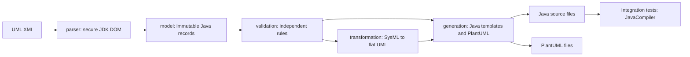

# UML code generator

A Java 17 command line tool that reads structural UML 2.5 XMI, checks a clean internal model, transforms SysML block models into flat UML classes, and generates Java sources and PlantUML class diagrams. It uses Maven, JUnit 5, the JDK XML parser, and a small template engine. There is no application framework or runtime dependency.

The GitHub Actions workflow builds and tests everything on a hosted runner. It needs no additional account, API key, local install, or local Docker. Generated artifacts can be downloaded from a completed [CI run](https://github.com/hamza2829/uml-code-generator/actions).

## Architecture



`parser`, `model`, `validation`, `transformation`, `generation`, and `cli` are separate Java packages. The parser indexes XMI ids before resolving references. Rules report all findings with severity, rule, element name, id, and message. An omitted type is a validation error. A dangling reference is a parser error with the input file and the referring element id. Broken XML uses the id `<document>` when no element id can be recovered. CLI errors contain no stack traces.

## Three commands

These commands run in CI. They also work in an environment that already has a Java 17 JDK and Maven. Local execution is optional.

Build, test, compile generated sources, and enforce 80% line coverage:

```sh
mvn --batch-mode --no-transfer-progress clean verify
```

Validate:

```sh
java -jar target/uml-code-generator-1.0.0.jar validate models/sensor-tracker.xmi
```

Generate Java and PlantUML, including the block-to-class transformation:

```sh
java -jar target/uml-code-generator-1.0.0.jar generate models/sensor-tracker.xmi --output generated/sensor-tracker --flatten
```

Omit `--flatten` to preserve UML package nesting and block classes. Java files go under `OUTPUT/java`; the diagram is `OUTPUT/model.puml`. Exit codes: `0` means success including warnings, `1` means model or processing error, and `2` means incorrect command syntax. Existing generated files are overwritten; stale files are not deleted, so use a fresh output directory when a model changes.

## Rules

| Rule | Severity | Checks |
| --- | --- | --- |
| unique-names | Error | Package members, properties, operation parameters, and enum literals |
| missing-types | Error | Properties, parameters, and explicitly declared returns |
| multiplicities | Error | Nonnegative lower bound and ordered bounds; `*` means unlimited |
| cyclic-generalization | Error | Cycles in generalizations and realizations |
| unnamed-elements | Error | Empty or whitespace names |
| naming-conventions | Error | Uppercase initial for classifiers, lowercase initial for properties, operations, and packages; valid Java identifiers |
| blocks-without-parts | Warning | A Block with no composite part properties; leaf blocks are allowed |
| java-structure | Error | Unsupported inheritance, erased duplicate signatures, final Object method conflicts, invalid part types |

## Samples

All sample files were written by hand in a namespace and reference style similar to Cameo and Eclipse Papyrus exports. They have not been exported from or certified by either tool.

| Model | Content | Expected result |
| --- | --- | --- |
| `models/library.xmi` | Nested package, enum, attributes, operation, binary association, list bounds | Valid |
| `models/sysml-rover.xmi` | Rover assembly, Block applications, value and part properties, fixed multiplicities | Valid with leaf-block warnings |
| `models/sensor-tracker.xmi` | Synthetic Aeris air defence sensor and radar tracker software structure, inheritance, interface, enum, system parts | Valid with leaf-block warnings |
| `models/contracts.xmi` | Interface inheritance, interface properties, realization, class-owned association ends, local primitive ids | Valid |
| `models/invalid.xmi` | Duplicate and unnamed elements, missing type, bad bounds, inheritance cycle, incorrect names, leaf Block | 10 errors and 1 warning |

The sensor example contains synthetic names and data structure only. It contains no real system specifications or tracking algorithms.

## Measured CI results

<!-- CI_METRICS_START -->
| Metric | Measured in GitHub Actions |
| --- | --- |
| Tests and line coverage | Awaiting the first completed CI measurement |
<!-- CI_METRICS_END -->

`ci/measure.py` sums the real Surefire XML test counts and reads the root JaCoCo LINE counter. It writes JSON, a Markdown table, and the Actions job summary. Coverage includes all production Java classes, including the CLI, with no exclusions. Parameterized invocations count as separate tests.

CI runs on every push and pull request. It uses `javax.tools.JavaCompiler` inside integration tests to compile both original and transformed versions of every valid sample. The packaged CLI then validates every sample, generates Java and PlantUML for each valid sample in both modes, and compiles that output again with `javac`. The invalid sample must exit with code 1 and match the exact expected finding counts.

The `generated-code-diagrams-and-reports` artifact contains generated source, `.puml` files, compiled sample classes, Surefire XML reports, JaCoCo HTML/XML/CSV, and measured metrics. No external coverage service or rendering service is required.

## Supported subset and limitations

This is a structural XMI subset, not a full UML or SysML implementation. It accepts a single UML Model, nested `packagedElement` packages, classes, interfaces, enumerations, attributes, operations with input and one return parameter, generalizations, interface realizations, and binary associations. XMI attributes are read by namespace and local name, including common Papyrus and OMG namespace versions. Primitive type references support local ids, `xmi:idref`, and standard UML library `href` fragments for String, Integer, Real, Boolean, and UnlimitedNatural. Other external model references are rejected. XML DTDs and external entities are disabled.

SysML Block applications use `base_Class`. Composite properties (`aggregation="composite"`) are part properties. Primitive properties of a Block are value properties. Other stereotypes and profile semantics are not implemented. The transformation removes Block stereotypes, retains classifier ids and type references, turns part properties into unidirectional associations, converts values to attributes, and puts classifiers into package `flat`. Repeated classifier names receive qualified prefixes and deterministic numeric suffixes.

Java generation uses boxed primitives, lists for upper bounds above one or unlimited, private fields, and public getters and setters. Optional single values are nullable. Lists start empty. Multiplicity constraints are checked on the model; generated setters do not enforce runtime cardinality. Binary associations generate fields in both directions when end role names are present; they do not synchronize opposite ends. UML visibility, ordered/unique collection semantics, default values, generics, templates, behavioral diagrams, constraints, ports, connectors, signals, dependencies, units, and vendor extension data are outside the supported subset. Operations generate stubs that throw `UnsupportedOperationException`; the model supplies signatures and documentation, not behavior.

Java supports one class parent. Enums with inheritance, non-class part targets, unsupported packaged element types, unsupported classifier children, and output/inout parameters are rejected. Conflicting inherited members and accessor collisions produce generation errors. Advanced covariant return resolution, arbitrary Java method overriding conflicts, and association-name collisions after flattening are not resolved. PlantUML text is generated and compared in tests; the workflow does not render diagram images or claim compatibility with all PlantUML versions.
